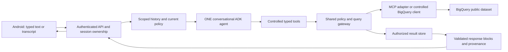

# Architecture and source tree



The agent can answer, clarify, call a tool, inspect an observation and call another tool. It is not a rigid classifier followed by a single query. There is no separate classifier or agent-service fleet in v1. Backend code owns authorization and validation, even when model instructions describe the same rules.

## Boundaries and modules

- API: token verification, limits, ownership, idempotency, SSE and cancellation.
- Agent: bounded orchestration and conversation, receiving only scoped context and tools.
- Domain registry: versioned metric definitions, dimensions, verified schema, allowed joins, templates and coverage.
- Gateway: canonical policy checks for every tool, SQL validation, dry run, billing cap, execution deadline and result shaping.
- Adapter: narrow transport abstraction for metadata, dry-run, submit, poll, page and cancel. The model never sees unrestricted MCP/API methods or credentials.
- Store: durable sessions, runs, event cursors, results and audit references. Proposed live store is Firestore with server-only access; local fixture store is in-process or SQLite. Select and pin the implementation in phase P0.
- Renderer: typed safe blocks; no arbitrary HTML, JavaScript or model-authored executable UI.

```text
android/                         # planned, README only today
  app/src/main/.../
    auth/ chat/ voice/ rendering/ data/ accessibility/
  app/src/sample/                # isolated fixtures and mock identity
  app/src/live/                  # verified login, no mock switch
backend/
  app/api/ auth/ policy/ agent/ domain/ gateway/ adapters/ storage/
  domain/thelook/                # verified schema, metric registry, templates
contracts/
  openapi.yaml                   # to be authored in P1
  schemas/                      # response, tool, event, domain contracts
  examples/                     # explicitly synthetic examples
infra/
  environments/ modules/ runbooks/
tests/
  fixtures/ unit/ contract/ security/ integration/ android/ evals/ live/
scripts/
  validate_specs.py              # exists; specification checks only
```

## Trust model

Android is untrusted. Chat text, SQL proposed by the model, tool arguments, database text, cached results and retrieved history are untrusted until checked. Verify identity before context reconstruction. Scope all stores and tools by identity, tenant and current policy. Database text is data, never instructions. Public dataset access does not justify exposing user-level fields or collecting personal-looking records.

Cloud Run instances are stateless workers; durable request/job mapping must survive restart. A task lease and reconciler recover accepted runs. Event replay reads authorized persisted events and never starts a new query. Details are in the lifecycle specification.

## Reuse existing platforms and keep scope small

The default remains a modular backend and one conversational agent. Semantic definitions and execution are an interface boundary: a future customer could supply an approved semantic service instead of raw BigQuery queries. This is a substitution point, not a commitment to build several cloud adapters now. Evaluate the customer's existing BI/analytics option before commercial expansion; see the [build-versus-buy review](15-product-charter-and-value-validation.md).

Per-run agent context must be isolated even when a worker handles concurrent users; no global mutable session history. Queue delivery, model invocation, query execution and event delivery have separate retry boundaries. Database query idempotency does not make every model invocation exactly once; account for retried inference cost and never start new attempts outside the run budget. Enterprise identity, data isolation and operating requirements remain conditional [future gates](16-enterprise-readiness.md).
