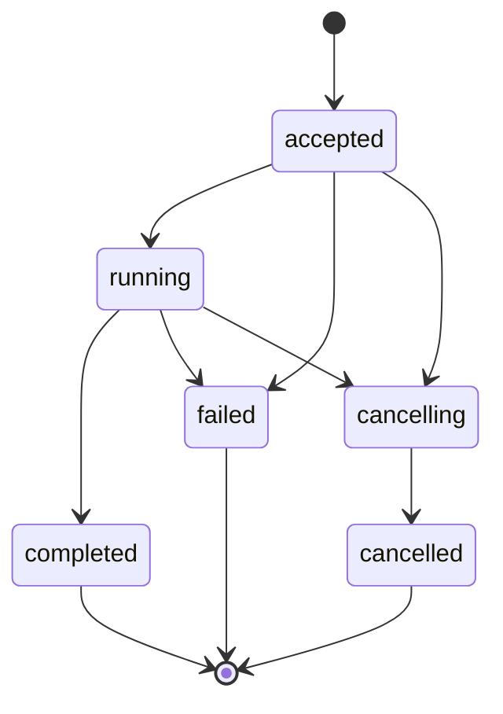

# State, storage and lifecycle

## Durable records

- Session: id, tenant, owner UID, created/updated times, domain version, active metric, grain, dates/timezone, dimensions, filters, prior result references, policy dependencies, revision.
- Turn: session ID, text, input kind, timestamps, originating policy version, sensitive lineage and safe display fragments. Summaries inherit the union of source dependencies.
- Run: id, owner, session, request hash/idempotency key, state, session revision, policy version, budgets/reservations, worker lease, tool attempts, validated query fingerprints, job ID/location, cancellation flag, terminal response.
- Result: owned normalized data, schema, completeness, lineage, policy version, freshness/expiry and provenance.
- Event: run/sequence, persisted safe payload, dependencies and retention expiry. Audit: nonsecret decisions and timings.

Default proposed retention: sessions/results/events 7 days, redacted security audit 30 days, result reuse freshness 15 minutes. Resolve privacy and operational requirements before live deployment. Expired results are not reconstructed from a model summary. Session deletion blocks access immediately, cancels work and queues deletion of turns/results/events; retain only required redacted audit metadata. Test deletion retry and TTL cleanup.

## State transition rules

A transaction serializes one active run per session and an idempotency key unique to UID/session. Same key + same canonical request returns the original run; same key + different payload returns 409. Retain keys at least 7 days; clients must not silently retry expired keys. Unique tool-execution records prevent retrying an already submitted query.

Before submission, persist a deterministic BigQuery job ID and location with the validated query fingerprint. If submission times out, look up that job before retry. Reject transport selection without an equivalent idempotency mechanism. Worker lease expiry triggers reconciliation of existing jobs and cancellation flags, never blind re-submission. Repeated callbacks/finalization use compare-and-set to ensure one terminal outcome.

Disconnect allows an accepted run to continue within its 60-second budget. Android reconnects using run ID and cursor. Stop sets cancellation atomically, stops model/tool work, and attempts job cancellation. If no job ID yet, submission checks cancellation before proceeding. BigQuery cancellation is best effort; audit actual final job state/bytes and explain that charges may already have accrued. Do not deliver late data after cancellation wins. If completion committed first, cancel returns completed. Test both orderings.

Before each context rebuild, tool call and output delivery, load current policy. A downgrade invalidates incompatible history/results/events and stops affected running work. Authorization barriers must cover events already queued for delivery; stream revocation cannot be left until next login. Policy-store failure fails closed. No implementation can retract data a user already saw.

## Follow-up merge algorithm

Resolve new explicit fields against the scoped domain; retain compatible prior metric/date/grain/filter fields; replace only mentioned dimensions/filters. Record the effective state shown with the answer. Clarify when a new metric makes old filters invalid, when “there/that” has multiple antecedents, or when a comparison lacks a baseline. Commit state only after valid clarification resolution or successful analysis; failures must not silently overwrite the last successful state. “As a table” changes presentation only if cached data is authorized, complete and sufficient. Otherwise explain the need for a new query or narrower scope.

## Clarification, expiry and revocation races

Keep pending clarification separately from last successful analytical state. When a user supplies only “January 2025,” resolve the saved missing-date question without losing its metric; cancellation/new-session resets the pending intent. Retention expiry (default seven days) controls storage availability; reuse freshness (default fifteen minutes) controls whether old values may answer a new analysis. Historical answers may be viewed with their original timestamp within retention if still authorized, but stale results cannot be silently reused for a new current answer.

Define the authorization linearization point as the final successful policy check immediately before server emission. A role change committed before this check must prevent the send; a change after it cannot retract bytes already handed to the transport. Do not claim absolute instantaneous revocation over in-flight network buffers. Serialize policy version checks and output admission, invalidate queued unadmitted batches, and test both race orderings. Stop/revocation can finish the application run while remote query cancellation remains pending; the reconciler retains job tracking until the real remote state is known.
