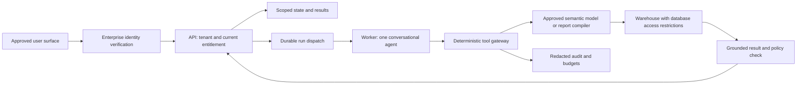

# Enterprise readiness and conditional admission gates

## Scope and verdict

The current repository is a specification-only learning project. It is not an enterprise product, approved private-data system or compliance certification. This document defines what must change **if** a private-data pilot or production service is later requested. It does not add enterprise work to the local sample lessons.

| Tier | Data and intended use | Admission evidence |
| --- | --- | --- |
| Learning demo | Synthetic fixtures; separately verified public TheLook queries | Existing P0–P7 tests and honest sample/live labels; no private customer data |
| Private-data pilot | One named organization, narrow read-only domain, bounded users and duration | E01–E08 and explicit sponsor/data/security approval; unneeded controls have a justified scope decision |
| Enterprise production | Sustained operational use within an agreed customer boundary | All applicable gates, operating ownership, support, recovery and procurement evidence; no inherited approval from a demo |

No gate is currently passed. Separate customer deployments are the preferred first pilot isolation hypothesis, subject to cost and customer constraints. A shared multi-tenant SaaS control plane, general connector marketplace and multi-cloud hosting are deferred. A dedicated deployment still needs user-level authorization within that customer.

## Gate register

| Gate | Concern / required capability | Evidence and accountable role |
| --- | --- | --- |
| E01 Business and scope | Named workflow, permitted decisions, domain boundaries, measurable baseline and human escalation | Sponsor signs pilot charter and success/stop criteria; product owner records build/buy comparison |
| E02 Identity and entitlements | Enterprise IdP/federation, tenant admission, group/role mapping, deprovisioning, session revocation and admin separation | Identity owner verifies employee/contractor lifecycle and negative access tests; no email-domain trust shortcut |
| E03 Data authorization | Approved warehouse/semantic scope with database enforcement of all required table/row/column restrictions | Data/security owners sign identity-to-source matrix; direct queries below the application cannot bypass scope |
| E04 Semantic and answer quality | Owned definitions, versioned releases, freshness rules, representative reviewed questions and correction workflow | Data steward signs definitions; independent reviewer adjudicates answers and failures, not just SQL execution |
| E05 Data handling and threat model | Data classification, model/speech-provider terms, regions, retention/deletion, logs, egress and sensitive inference | Security/privacy owners approve data-flow inventory, threat model and actual provider/configuration evidence |
| E06 Reliable operation and cost | Durable workers, bounded concurrency, queue expiry, spend controls, dependency failures, recovery and support | Engineering/SRE owner demonstrates load/failure/restore tests and agreed SLIs/SLOs; finance/sponsor approves budgets |
| E07 Change and supply chain | Immutable versioned releases, dependency/image review, migrations, rollback, prompt/model/metric regression gates | Release owner records provenance, vulnerability triage, regression evidence and reversible rollout |
| E08 Pilot governance | Named administrator, audited grant/revoke, incident response, support hours, approved participants and no accidental public sharing | Pilot owner verifies access review, escalation exercise and controlled rollout |
| E09 Production procurement and continuity | Required supplier/legal/privacy agreements, license/IP decision, support commitments, offboarding and customer-specific assurance | Authorized owners approve actual artifacts; documentation does not claim SOC 2/ISO/GDPR compliance |

## Enterprise architecture choices to validate

The learning architecture remains one backend codebase and one agent. A separate worker process/deployment, when required for durability, is not a second conversational agent. Keep per-request state out of singleton agent objects; concurrency tests must prove no user history or credentials bleed across runs.

**Identity:** Firebase Google sign-in remains the demo default, not proof of enterprise SSO. Before a private pilot, select an identity integration that satisfies the customer's federation, MFA/conditional-access and lifecycle requirements. Map trusted subject/issuer to organization membership; do not let a client select tenant identity or assert role/group scope. SCIM or another audited provisioning process is a customer-dependent choice, not an assumed v1 feature.

**Database boundary:** A shared service account usually executes as that service account; logging the end user's UID does not make warehouse row policies run as that user. Choose a supported delegated identity path, or separately constrained identities/views/datasets for each admitted scope. Prove the mapping with direct-source tests. Do not grant an execution identity broad raw-table access that makes approved views bypassable. Row security is not an appended SQL filter. BigQuery documents tradeoffs among row policies, authorized views and separate tables; choose from actual sensitivity and isolation needs. [BigQuery row-level security](https://docs.cloud.google.com/bigquery/docs/row-level-security-intro)

**Tenant boundary:** Carry identity through deterministic code, queue payload lookup, tool gateway, caches, result storage, audit and configuration. Tools cannot select credentials/endpoints/tenants. Azure's agent architecture guidance explicitly treats tenant propagation and isolation as deterministic controls. [Multitenant agent considerations](https://learn.microsoft.com/en-us/azure/architecture/guide/multitenant/considerations/agentic-systems)

**Semantic boundary:** Prefer the customer's existing approved semantic model when available. Otherwise use a finite report/query-plan compiler with approved metrics and joins. Generated SQL remains a disabled advanced route until its supported grammar, permissions and metric semantics are independently tested. An LLM judge or successful dry run cannot establish arbitrary SQL equivalence or business correctness. Do not build a general SQL security engine merely to launch a pilot.

## Data handling is broader than BigQuery access

Document every data path: warehouse → tools → result store → model context → output → Android, plus prompts, transcripts, voice provider, telemetry, backups and support access. Record data class, processing region, recipient/provider, retention, encryption/access policy, deletion behavior and owner. “No training on customer data” is not the same as “no storage”; check the actual service/model/endpoint and configuration. Google's model data-governance documentation describes retention and caching conditions. [Data-governance reference](https://docs.cloud.google.com/gemini-enterprise-agent-platform/resources/zero-data-retention)

For private use, disable voice until the speech provider and device behavior meet the approved data policy. Default to aggregate/minimized model context. Exclude raw identifiers and sensitive fields unless the use case and policy specifically authorize them. Review small-group and differencing attacks: minimum group sizes alone do not prevent all inference. Restrict dimensions/query combinations or decline the workload where necessary; do not claim anonymization from aggregation alone.

Human-readable result references are not public share links. Export/sharing remains out of demo scope; any future sharing must reauthorize the recipient and respect retention/classification. Device clipboard, notifications, backups, screenshots and management requirements need a customer-specific policy. Server revocation cannot recall a screenshot or bytes already seen.

Application deletion must distinguish immediate access revocation from asynchronous physical deletion in stores, provider retention and backups. Record deletion completion/retry and legitimate retention requirements with the responsible owner. Do not promise instantaneous global erasure or unrestricted legal-hold behavior based on a TTL setting.

## Reliability and cost qualification

Define SLIs before choosing numeric production promises: accepted-request availability, time to first status, time to correctly grounded answer, unexpected execution error rate, duplicate query count, cancellation resolution and authorized-result availability. Measure denied/clarification/unsupported outcomes separately; never inflate useful-answer success by counting a refusal as a solved business question.

For the learning load experiment, use a proposed envelope of 10 concurrently active runs and 50 open SSE connections, including slow/disconnected clients, over 30 minutes. This is a test workload, not a claim of capacity. Preserve one active run per session; configure per-user/tenant/global admission quotas, bounded queues, provider quota handling and 429/backoff. In-memory semaphores alone do not enforce multi-instance caps. Include replay and polling in resource limits. Record cold-start and warm-run latency separately; the existing 2-second/30-second targets remain unverified goals.

For a real pilot, negotiate load envelope, availability target, recovery time objective (RTO), recovery point objective (RPO), support hours and budget based on the actual decision risk. Perform restoration and failed-worker drills. A regional failover design must honor data residency and model availability; do not automatically add cross-region replication or promise an SLA.

A plausible GCP worker option is Cloud Tasks with a private worker and authenticated task delivery, plus transactional outbox/reconciliation for accepted runs. This is an option, not a provisioned or selected dependency. Design for duplicates and delayed delivery; expired runs must not begin new model/query work. The API's acceptance transaction, job IDs, leases and terminal state—not queue marketing—own idempotency. [Cloud Tasks limitations](https://docs.cloud.google.com/tasks/docs/common-pitfalls)

Maintain a kill switch for live querying and a bounded degraded mode: explain the outage, offer an already-authorized historical result clearly dated if policy permits, or direct the user to the established analytics process. Never substitute synthetic answers or an unapproved model/provider. Monitor total service costs, not just inference tokens. Stewardship, integration and support may dominate infrastructure cost.

## Trust, feedback and operating ownership

Give users a way to inspect metric definition, filters, dates, data freshness and limitations and to flag an answer. Numeric grounding also needs semantic correctness: a number can be copied accurately from the wrong metric. Route reported wrong answers to an authorized reviewer; feedback never automatically changes production prompts, metrics or permissions. Store only necessary protected evidence. Customer question sets and answer traces must stay outside this public repository unless explicitly cleared.

For mobile API changes, test the oldest supported client contract, define a support/deprecation window and use a new protocol version for incompatible changes. Include storage migrations and rollback compatibility; forcing old clients to accept unknown fields is not a compatibility strategy.

Before changes to model, prompt, tool schema, parser, domain mapping or policy, rerun representative regressions and security tests, review diffs and retain rollback references. Monitor quality after release; source/model changes can invalidate earlier success. AWS recommends ongoing agent evaluation, including human review and use-case-specific evidence. [Continuous evaluation](https://docs.aws.amazon.com/wellarchitected/latest/agentic-ai-lens/agentops06-bp02.html)

E01–E09 are conditional future gates. The actionable next step remains the local learning path, not implementing every enterprise capability now.
