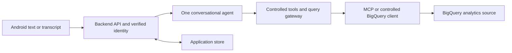

# Component-by-component setup guide

This guide explains what to prepare, configure, build and connect, component by component. It complements the [learning path](13-learning-path.md) and [implementation plan](09-implementation-plan.md); it is not a clone-and-environment-file quickstart.

**Current status:** specifications only. None of the application components below exists or has passed its checkpoint yet. “Build” means implementation work still to do. Cloud setup instructions are future actions in an authorized environment; writing this guide has not created resources, enabled APIs or granted permissions.

## How to follow this guide

Start with the sample route in steps 1–4 to get a working phone-to-backend journey without paid cloud services. Then add identity, persistence, query controls and the agent in steps 5–8. Add voice in step 9 and verify/deploy in step 10. Live subsections in steps 1–2 describe dependencies to revisit when step 7 is ready; they do not require cloud setup before the first sample.

There are two different kinds of storage:

| Component | Stores | Setup approach |
| --- | --- | --- |
| Analytics source | Ecommerce facts used to calculate answers | Synthetic fixtures first; public BigQuery dataset in place later |
| Application store | Memberships, sessions, runs, results, event cursors and audit references | Local test store first; proposed server-only Firestore later |

The runtime path is:

This runtime diagram does not mean we build the model first. A scripted sample lets us construct and test the surrounding system independently.

## 1. Set up the analytics data foundation

**Purpose:** know which data we can query and what the numbers mean before introducing an LLM.

### 1.1 Create the synthetic learning data — build first

1. Read the logical entities and metric rules in [data and metrics](03-data-and-metrics.md).
2. Create local fixture records for products, orders and order items using the exact synthetic scenario in [testing](08-testing-and-operations.md). Use invented IDs, dates, countries and demo units; do not download customer rows.
3. Store the fixtures under the planned `tests/fixtures/` area. A local fixture adapter should read them without BigQuery, MCP or model credentials. No cloud database is needed for this step.
4. Implement an independent reference calculation and confirm January sales = 190 demo units, January orders = 2, January average = 95, and January Germany sales = 150.
5. Add a cancelled order, a null amount and a duplicate key case. Confirm the documented exclusion, unknown-value and rejection behavior.

**Checkpoint:** the fixture reference results are reproducible. We can explain why joining order/items incorrectly changes a result.

### 1.2 Prepare BigQuery access — revisit before live queries

1. In the Google Cloud project selector, resolve the intended project by its exact ID/number and confirm its owner. A spoken display name is insufficient. Record operational values privately.
2. Check BigQuery API availability, billing/sandbox constraints, organization restrictions and the approved query budget. Have the environment owner authorize any required changes; do not modify another app's project configuration casually.
3. In the BigQuery workspace, locate `bigquery-public-data.thelook_ecommerce`. Inspect its dataset details and actual location. It is the source, not our billing project.
4. Inspect candidate tables `users`, `orders`, `order_items`, `products`. Record exact fields/types, keys, status values, timestamp meanings, nulls, date/country coverage and currency evidence. Do not infer these from the demo fixtures.
5. Separate job-execution permission in our project from source-data read permission. Use a dedicated backend execution identity with the minimum required scope. Public access may already provide source access; do not attempt to grant permissions on Google's public project.
6. Prepare one reviewed aggregate query using the inspected schema. Dry-run it first, inspect estimated bytes, and submit only with an explicit maximum-bytes cap and location through a supported client/configuration. Avoid a full-table exploratory export. A `LIMIT` alone is not a scan-cost cap.
7. Save a sanitized metadata/quality report and approved field mappings in the planned domain registry. Keep credentials, raw user records and account configuration out of Git.

**Checkpoint:** a separately authorized bounded live query succeeds with recorded source location, semantics and cost evidence. No source tables were copied or created. If access, currency or mappings remain unclear, continue using fixtures.

Reference: [BigQuery public datasets](https://docs.cloud.google.com/bigquery/public-data). The public source is queried in place; query execution still needs appropriate access and cost controls.

## 2. Set up the MCP connection and adapter boundary

**Purpose:** understand how the backend reaches data tools. MCP supplies a tool protocol; it does not provide the conversation or our role policy.

### 2.1 Define and fake the adapter — build first

1. Define backend operations for permitted metadata, dry-run, submit, status, result pages and cancellation. Keep the model-facing tools narrower than these internal operations.
2. Implement a fake adapter that returns fixture data and records which operations were called. Give it controlled failure, slow-query and partial-result modes.
3. Use this fake in the first backend/Android sample. Do not require a local MCP service just to display a fixture answer.

**Checkpoint:** tests can prove that a greeting or denied request makes zero query calls, without a cloud account.

### 2.2 Connect to Google's managed BigQuery MCP service — live extension

1. Use the managed server as the default: endpoint `https://bigquery.googleapis.com/mcp`, Streamable HTTP transport. We are connecting to a server operated by Google, not installing a new database or deploying our own MCP server.
2. Review the current [BigQuery MCP setup documentation](https://docs.cloud.google.com/bigquery/docs/use-bigquery-mcp). Check MCP tool-call permission, job creation and source read access for the backend identity. The documentation lists MCP Tool User, BigQuery Job User and BigQuery Data Viewer roles; scope only permissions actually needed. An application role such as catalog_viewer is separate from a Google IAM role.
3. Configure a supported backend MCP client with Google OAuth credentials for that identity. Keep tokens server-side and out of logs. Firebase user ID tokens are not a substitute for Google Cloud tool credentials.
4. Inspect the server's actual `tools/list` response and save a sanitized schema snapshot. Listing tools is not proof that the identity can execute them.
5. Build an explicit capability matrix: metadata scope, read-only execution, dry-run, maximum bytes billed, job identity/idempotency, location, timeout, paging and cancellation. Mark each verified, unavailable or untested.
6. Do not expose the server's entire tool catalog to the agent. Expose only the controlled application tools described in [the gateway specification](05-agent-and-query-gateway.md).
7. If MCP lacks mandatory execution controls, use the BigQuery client for controlled dry-run/execution/poll/cancel behind that same gateway. MCP can still supply suitable scoped metadata. Never dry-run safely and then submit through an uncontrolled route.

**Checkpoint:** we know which transport owns each adapter operation and why. Actual live execution waits for step 7's policy/budget tests. Missing controls keep the execution route disabled.

Reference: [BigQuery MCP tool reference](https://docs.cloud.google.com/bigquery/docs/reference/mcp). A self-hosted Toolbox/MCP service is an optional later architecture exercise, not a required second server for this project.

## 3. Set up the backend endpoints — build against fixtures

**Purpose:** make a complete API conversation work before adding real analytics or model variability.

### 3.1 Define the boundary

1. Choose and record compatible pinned Python/FastAPI and schema-library versions.
2. Turn [the API design](06-api-and-contracts.md) into OpenAPI and closed JSON Schemas, with full valid/invalid synthetic examples.
3. Split API, identity, policy, storage, agent and adapter modules. Use injected interfaces so the API can run with a scripted responder and fake query adapter.
4. Create a loopback-only sample server. Its synthetic identities are allowed only in sample mode; live mode must reject that configuration.

### 3.2 Add endpoints in this order

1. Session creation/read/list/delete: own every session by the injected principal; do not accept a role or owner in the body.
2. Run creation/status: accept a message, assign a run ID, enforce the idempotency key and one-active-run rule.
3. Events: send accepted/status/final/done over SSE with monotonically numbered persisted events.
4. Result retrieval: return typed columns/rows/blocks and provenance; enforce ownership and bounded paging.
5. Cancellation: set the run cancellation flag and suppress late results; first use a slow fake job to test it.
6. Consistent errors: distinguish invalid input, authentication failure, inaccessible resources, denial, no data, unsupported and execution failure.

### 3.3 Prove the backend without Android

1. Send “Hi” through an HTTP test client and inspect a greeting with zero query jobs.
2. Ask the sample January sales question and inspect a metric pointing to 190 demo units in the stored result.
3. Repeat an identical request/key, disconnect the stream, then reconnect using the run/cursor. Confirm the original run is reused.
4. Attempt another synthetic user's session/result; confirm no data is disclosed.

**Checkpoint:** contract/integration tests pass and sample responses are labeled sample throughout. No model is needed. Exact start/test commands become part of the lesson note once this code exists; none are claimed runnable today.

## 4. Set up the Android app — connect it to the sample API

**Purpose:** build the visible experience around a stable contract.

1. Create a new independent Kotlin/Jetpack Compose project under `android/`, with its own package identifier and compatible Gradle/JDK/SDK decisions. Do not reuse or modify another user app.
2. Create separate sample and live build flavors. The sample uses synthetic login; the live flavor contains no role switch or mock-auth fallback.
3. Build the first screen: conversation list, message field, Send, loading/status, Stop and visible sample banner.
4. Add a network repository and ViewModel state. Send to the backend only; Android never connects to BigQuery or MCP directly.
5. Connect emulator or USB device to the loopback sample backend through a verified local adb tunnel. Keep any local HTTP exception confined to sample/debug. Document the actual chosen port/tunnel commands after testing.
6. Render a metric card, line/bar chart and table using the contract field references. Add details for definitions, filters, timestamps and limitations. Reject malformed blocks.
7. Preserve run ID and event cursor through rotation/process restoration. Refresh/replay rather than blindly issuing another Send.
8. Test TalkBack labels, large text, dark theme, keyboard behavior, narrow screens, loading, no-data, denial and network failure.

**Checkpoint:** a person can complete greeting → January sales → Germany follow-up → table view in the sample app. Voice and live login can wait.

Reference: [Compose project setup](https://developer.android.com/develop/ui/compose/setup). Project generation alone does not implement the application flow.

## 5. Set up authentication and the two user roles

**Purpose:** separate “who is signed in?” from “which data may they access?”

1. First test identity/policy interfaces using synthetic principals: analyst, catalog viewer and unassigned. Fake identity is never permitted in live mode.
2. For live login, confirm the intended Firebase project and Android registration; enable the chosen Google sign-in provider with authorization. Configure the package and signing fingerprints required by the current identity setup.
3. Implement Android sign-in using the supported Firebase/Android flow. Send the resulting Firebase ID token to the backend over TLS, not a role string.
4. Verify signature, issuer, audience, expiry and explicit revocation checks server-side. Fail closed when verification or current membership lookup fails.
5. Create the server-owned membership mapping for verified UID/tenant, enabled status, role and policy version. Bootstrap roles through an audited operator action outside the public API.
6. Permit analyst sales/product capabilities, viewer product capabilities, and no data capabilities for unassigned users. Scope tool discovery, history and saved results as well as new queries.
7. Test expired token, forged role, wrong user, disabled membership and a downgrade during a stream. Confirm a viewer cannot reuse a previous analyst answer after revocation.

**Checkpoint:** identities and current roles are enforced at backend boundaries. The live UI has no self-service role toggle.

References: [Firebase Google sign-in on Android](https://firebase.google.com/docs/auth/android/google-signin), [server ID-token verification](https://firebase.google.com/docs/auth/admin/verify-id-tokens). Follow the current SDK integration instructions; application authorization remains our responsibility.

## 6. Set up application storage and reliable conversation processing

**Purpose:** preserve the conversation safely and recover without duplicate queries.

1. Implement the storage interface locally first. Store sessions, turns, runs, events, results, membership versions and query-job references with explicit ownership.
2. Add transactions/compare-and-set behavior for idempotency, active-session runs, worker leases and one terminal outcome. A global Python dictionary is not the production persistence design.
3. Store last successful analytical state separately from pending clarification, so a reply such as “January 2025” completes the earlier question correctly.
4. If Firestore is selected for live storage, create/configure it only after region, identity, cost and retention decisions. Backend service identity owns access; Android does not directly read/write these collections.
5. Restrict mobile/web client access and separately restrict server IAM. Firestore server libraries bypass client Security Rules; those rules alone cannot protect data from a broad server identity. [Firestore access-control behavior](https://firebase.google.com/docs/firestore/security/rules-conditions)
6. Implement atomic acceptance plus dispatch intent, a worker lease and a reconciler. Recover a crash between accepting and dispatching a run. Handle duplicate work delivery without starting a second query.
7. Enforce the acceptance-to-deadline limit, cancellation and retention cleanup. A timed-out accepted run must eventually become terminal and release the session; track any still-running remote job separately.
8. Test restart, replay, expired results, session deletion and permission changes. Old authorized history can show its original timestamp; stale values cannot silently become a new answer.

**Checkpoint:** restarting the service does not lose an accepted run or duplicate a submitted query. Live end-to-end integration must not skip this checkpoint.

## 7. Set up the safe query gateway and real reports

**Purpose:** establish that an answer is authorized, affordable and semantically correct before allowing the agent to request it.

1. Create the reviewed metric registry: definitions, source mappings, eligible statuses, date basis, joins, null/zero handling, permitted dimensions, units and owner/version.
2. Implement approved report templates and the finite typed analysis-plan compiler. Start with one monthly sales report; then catalog, country/category comparisons and category growth. Keep generated SQL disabled.
3. Put all routes through the same policy, SQL/lineage, parameter, dry-run, cost, deadline and output checks. Never let the transport or model authorize a request.
4. Run fixture cases first, including wrong joins, missing amounts, zero baselines and attempted unauthorized columns/tables.
5. Revisit steps 1.2 and 2.2 when live setup is authorized. Confirm the verified source mappings and adapter capability matrix, then enable only the compliant route.
6. Execute one bounded report with a known reviewed reference query. Compare actual results at the same observation time; fixture numbers are not live expected totals.
7. Save a deterministic job ID before submission, reconcile uncertain submissions, and implement polling, bounded pagination and best-effort cancellation. Retain budget reservations until uncertain cost is reconciled.
8. Validate complete/partial/empty output and attach provenance before the result can reach the model or Android.

**Checkpoint:** a non-LLM test client can request the approved report and receive correct, permission-scoped results within limits. If this fails, adding an agent is not the next debugging step.

## 8. Set up the conversational agent and connect its tools

**Purpose:** turn a sequence of user messages into direct answers, clarifications or controlled analytical actions.

1. Begin with a scripted responder that passes the same tool contracts; keep it for deterministic tests.
2. Select compatible Google ADK/model SDK versions. For live inference, verify an available tool-calling Gemini model, endpoint/region, permission and budget; record the actual model identifier. Do not guess a fixed model/version from this document.
3. Create one conversational agent. Provide scoped domain definitions, approved capabilities and authorized history/state. Do not send whole source tables or denied history.
4. Register only discover_capabilities, standard_report, custom_analysis and reuse_result as controlled application tools. Custom analysis uses the finite plan by default; do not attach a raw unrestricted MCP toolset.
5. Implement the bounded model/tool loop: message → answer/clarify/tool → observation → next step → validated final response. Enforce budgets outside the agent.
6. Verify “Hi” and conceptual questions require no database job; “Now only Germany” preserves dates/metric; “Show that as a table” reuses sufficient authorized data.
7. Check unsupported/ambiguous requests and invalid numeric claims. Prefer a clarification or grounded deterministic result explanation to an invented answer.
8. Connect this provider to the already-tested API only after identity, state and gateway checkpoints pass. Do not redesign the Android endpoint contract around the model SDK.

**Checkpoint:** the same app workflow now uses the agent without weakening permission, result or cost checks. Sample and live are still visibly distinct.

References: [ADK agent concepts](https://adk.dev/agents/llm-agents/), [ADK MCP integration](https://google.github.io/adk-docs/tools-custom/mcp-tools/). Optional generated SQL is a separate advanced lesson after this checkpoint.

## 9. Set up push-to-talk voice input

**Purpose:** make speaking another way to enter a message, using the same backend conversation.

1. Define a speech-input interface and use the supported Android recognition service behind it. Verify service availability and provider/network behavior on the test device.
2. Request microphone permission at first use; show recording, Stop and error states.
3. Display the transcript for correction and explicit Send. Do not automatically send partial recognition results as multiple chat messages.
4. Submit the final transcript through the same run endpoint with input_kind = voice_transcript. Keep permissions, state and idempotency identical to typed messages.
5. Retain typed input when permission is denied or recognition fails. Do not store raw audio by default.
6. Test interruptions, backgrounding, cancellation, offline behavior and at least one physical device. Enterprise voice processing remains subject to the later provider/privacy gate.

**Checkpoint:** the same question typed or spoken produces the same effective analytical request. Continuous voice and speech output remain out of v1 scope.

## 10. Verify the whole system, then optionally deploy

**Purpose:** establish working evidence and operate only the scope that has passed checks.

1. Run the deterministic contract/fixture/security suite and held-out conversation evaluations in [testing and operations](08-testing-and-operations.md). Separate model evaluations from fast no-cloud CI.
2. Demonstrate both roles, unassigned denial, malformed chart rejection, data absence, revoked access, duplicate Send, Stop, reconnect and failed queries. Record failures as well as successful demonstrations.
3. Add redacted run/tool timing, query/model usage, denial reasons, budget rejections and result-quality feedback. Confirm logs contain no tokens/audio/raw sensitive payloads.
4. Select a durable worker/deployment arrangement only after its retry, identity and quota behavior is understood. Record the queue/dispatch decision and test worker loss before claiming resilience.
5. For an authorized staging deployment, configure Cloud Run, workload identity, server-only storage, secrets, HTTPS, budgets and restricted worker invocation using the [deployment guide](10-setup-and-deployment.md). Review the resource plan first; no infrastructure is created by following local lessons.
6. Point the live Android flavor at the verified HTTPS API. Run the same journeys on a physical device and inspect actual costs and source provenance.
7. Record release/image/model/domain versions, supported setup commands, test evidence and rollback/disable-query procedure. Verify the clean-checkout sample still works independently of the live service.
8. Mark each component local-verified or live-verified only after its checkpoint. Any unverified feature remains explicitly unavailable. A public-data demo release does not authorize private enterprise data.

**Checkpoint:** we can reproduce the supported demo, explain every component and failure boundary, and identify what is still unverified. Cloud deployment remains optional until separately authorized.

## Progress record for each step

Use these fields in a lesson note once implementation begins:

| Field | Record |
| --- | --- |
| Component and checkpoint | Which numbered step/substep was completed |
| Status | Planned / built locally / local verified / live verified / blocked |
| Dependency evidence | Earlier checkpoints and pinned tool/contract versions |
| Setup/build actions | Actual actions taken, not merely the intended checklist |
| Verification | Exact command or UI procedure, expected result, actual result, sanitized evidence |
| Costs and access | Whether cloud/model calls occurred and which approved scope was used |
| Failure exercise | What failed deliberately and how recovery/denial behaved |
| Remaining work | Unimplemented parts and next substep |

Keep the [implementation plan](09-implementation-plan.md) authoritative for dependency gates. This guide groups the work by component; it does not bypass earlier policy or contract requirements. Exact SDK commands and screenshots belong in the implemented lesson notes after they have been tested, not as fictional runnable instructions here.
